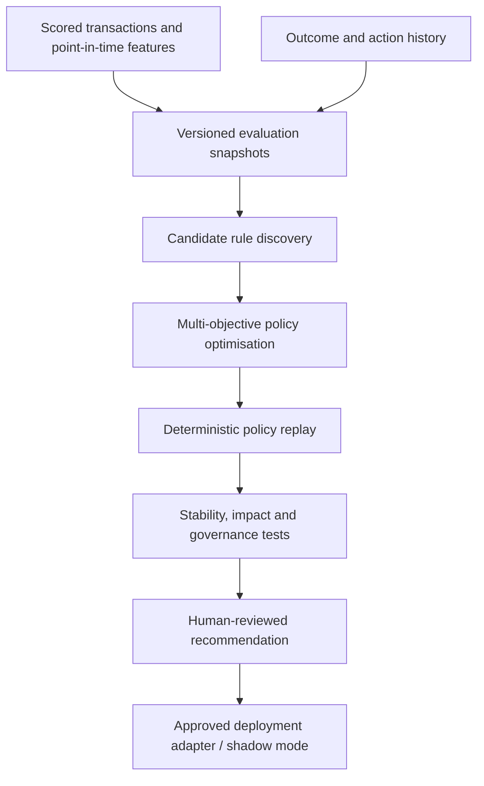

# NEMESIS — Complete Technical Approach

**Next-generation Evolutionary Multi-objective Engine for Strategy, Intervention and Stability**  
*Fraud evolves. So do we.*

**Status:** Technical proposal / discussion draft  
**Version:** 1.0 — 27 October 2026  
**Audience:** Fraud Strategy, Applied AI / Machine Learning Engineering, Data Engineering, Technology, Fraud Operations, Model Risk, Risk Owners and Architecture Review  
**Classification:** Illustrative design; contains no customer data or confidential rule definitions

---

## 1. Executive summary

NEMESIS is a proposed platform for continuously discovering, testing, selecting and recommending fraud decision rules. It works on the entire scored transaction population rather than optimising individual rules in isolation. The desired outcome is a measurable improvement in **fraud transaction detection, fraudulent attempted-value detection and strategy stability**, with explicit limits on genuine-customer declines, challenges, manual reviews, latency, complexity and other risk-appetite constraints.

The bank currently scores **more than 100 million transactions per month** through machine-learning models. A separate, internally developed rules engine consumes the model scores, model features and additional contextual data and chooses an operational action: **ALLOW, CHALLENGE, REVIEW or DECLINE**. More than 100 people contribute to optimising fraud rules. Historical fraud labels are available, including for non-alerted transactions. These conditions make systematic, data-driven strategy optimisation attractive.

**Fundamental design choice:** NEMESIS is initially an **offline, deterministic, governed optimisation and simulation platform**, with an optional agentic research assistant layered on top. Neither Amazon Bedrock nor GPU inference is required to build its first useful version. The live payments engine remains unchanged in the MVP.

**Important integration choice:** Access to existing rule *definitions* is desirable but **not a prerequisite**. NEMESIS can discover and optimise a standalone challenger policy from scored historical transactions and labelled outcomes. To estimate incremental benefit against the incumbent strategy, it needs at least the historic final actions; to replay incumbent semantics exactly, it additionally needs rule definitions or a black-box engine interface. In the complete absence of these, it must label results **standalone historical coverage**, not incremental production gains.

The first practical milestone is to process a representative historical cohort (initially approximately 10 million scoring decisions), demonstrate a reproducible baseline, discover or tune constrained candidate rules, evaluate their jointly resolved decisions and produce a ranked, auditable set of recommendations. The full data platform is designed to scale to 100 million+ scored transactions each month and historical populations in the billions.

### Target outcomes

1. **More fraud coverage:** increase the number of known fraudulent attempted transactions selected for intervention at a matched level of genuine-customer impact.
2. **More value coverage:** increase the monetary value of known fraudulent attempts selected for intervention, with appropriate controls against overfitting a handful of extreme amounts.
3. **Stability:** reject strategies that perform well only in narrow historical windows, customer segments or channels.
4. **Lower operating burden:** reduce redundant rules and unnecessary interventions while respecting fraud and business controls.
5. **Faster change cycles:** automate analysis, rule search, backtesting, evidence generation and human review preparation.
6. **Control and auditability:** publish only deterministic, versioned, explainable recommendations backed by reproducible evidence.

### Explicit non-goals for the first release

- No autonomous modification of live payment policies.
- No LLM or agent in the millisecond payment authorisation path.
- No assumption that an intervention on a historically fraudulent attempt would necessarily have prevented an equivalent amount of net loss.
- No claim that missing outcomes of previously declined transactions are known.
- No replacement of the existing rules engine before integration and policy governance are established.

---

## 2. Current state and key design assumptions

| Dimension | Current understanding | Implication |
|---|---|---|
| Scoring volume | More than 100 million transactions per month | Distributed historical processing; incremental optimisation and selective full replay |
| Model output | Fraud score plus associated features | Score-conditioned rule discovery and segmented thresholds |
| Context | Additional data available to rules engine | Candidate predicates can extend beyond scores if point-in-time reproducible |
| Existing rules | Internal engine; definitions may be inaccessible | Independent rule DSL and challenger architecture; adapter later |
| Fraud outcomes | Historical outcomes linked to alerted and non-alerted transactions | Broad retrospective coverage, subject to label delay and intervention bias |
| Action space | Allow, challenge, review, decline | Multi-action economics, rather than a single alert threshold |
| Human optimisation | 100+ people participating | Significant opportunity for repeatability, standardisation and coverage |
| Existing platform | Databricks, AWS, MLflow, Bedrock, CI/CD and monitoring | Reuse operating infrastructure rather than introduce a separate stack |
| Payment processing | Low-latency real-time service | Offline optimisation must not add synchronous latency |

**Assumptions requiring confirmation:** the exact transaction count refers to scoring attempts rather than unique logical payments; score versions can be identified; data are usable for retrospective strategy experimentation under internal access controls; labels are sufficiently mature for selected portfolios; intervention logs exist; and approved features can be reconstructed as of each decision timestamp. These are not established facts.

## 3. Architecture: two deliberately separate planes

### 3.1 Offline research, optimisation and governance plane



The core computational components are Python and Spark jobs orchestrated through the existing data platform. Candidate policy definitions are structured and typed, rather than arbitrary executable strings. Evaluation results, data snapshots, code hashes and policy versions are registered in MLflow or the existing equivalent experiment registry.

### 3.2 Online decisioning plane

The existing ML scoring service and production rules engine retain full control of real-time payment decisions. NEMESIS initially has **no live write privileges**. During later shadow mode, it may consume a duplicated event stream and produce hypothetical decisions without changing the customer action. Any approved policy translation occurs via a controlled engine-specific adapter and normal change process.

### 3.3 Optional agentic plane

An LLM-based coordinator may eventually formulate rule hypotheses, launch bounded experiments, interpret Pareto trade-offs, investigate data drift and prepare change requests. **It never calculates policy metrics itself as a source of truth** and never publishes rules directly. Agent outputs are hypotheses and narratives grounded in deterministic tool results.

Agents are an enhancement to research productivity, **not the optimisation algorithm**. The MVP can be delivered without Amazon Bedrock, LLM APIs, GPUs or a multi-agent framework.

---

## 4. Working without access to incumbent rules

The architecture supports three access levels. This prevents rule ownership or security constraints from becoming a binary blocker.

| Access level | Available information | NEMESIS capability | Evidence that remains unavailable |
|---|---|---|---|
| A — Full or executable | Definitions, or a callable engine, plus historic actions | Incumbent replay, parity testing, challenger comparison and policy interaction analysis | Causal effect of different interventions without appropriate observational or prospective evidence |
| B — Decision logs only | Final historic action; ideally fired IDs and policy version | Standalone challenger and transaction-level decision disagreement / opportunity analysis | Exact incumbent rule semantics and hypothetical incumbent behaviour under new context |
| C — No rule access and no decisions | Scored transactions, features, outcomes only | Standalone constrained rule discovery and backtesting | Incremental benefit relative to the incumbent, decision precedence and incumbent friction |

**Recommended default: independent challenger architecture.** Define NEMESIS rules in an engine-neutral policy DSL. Discover and optimise them with the local simulator. Request a narrow historical-decision data contract from the rules owners, rather than insist on sharing their entire source code. Integrate an engine adapter only after useful candidates are shown.

When decision logs exist, compare challenger and production actions on the same attempt. For example, identify known fraudulent transactions the challenger would have challenged or declined while production allowed them, alongside genuine transactions where the challenger would add friction. These are **disagreement and historical-coverage opportunities**, not automatically proven prevented losses.

When neither incumbent actions nor callable rules exist, do not fabricate the incumbent baseline by treating `score > threshold` as the actual production policy. A separately learned *surrogate* of incumbent decisions is possible if labelled action examples later become available, but should only be used for exploratory analysis, with model error clearly quantified.

### 4.1 Minimum integration request

Without requesting rule content, seek the following fields per attempt:

```text
decision_id, logical_payment_id, event_timestamp,
production_action, action_timestamp,
ruleset_version [preferable], fired_rule_ids [optional],
challenge_result [if applicable], review_result [if applicable],
settlement_status, decline_reason_category [optional]
```

This small interface dramatically strengthens policy comparison. A read-only **black-box batch evaluation endpoint** is another acceptable route if internal teams can execute historic transactions through an approved engine snapshot and return resolved actions plus traces.

---

## 5. Data architecture and schema

### 5.1 Storage layers

1. **Bronze / raw:** immutable transaction scoring events; decision, challenge, review and settlement events; delayed fraud outcomes; relevant reference data.
2. **Silver / curated:** deduplicated attempt-level records; point-in-time score and feature snapshots; correctly sequenced interventions; verified label maturity; canonical currencies and loss definitions.
3. **Gold / experiment snapshots:** frozen, versioned cohorts used in a specific optimisation study, with immutable input references and explicit labels as-of a cutoff.
4. **Results:** candidate predicates, compiled policy versions, per-period metrics, confidence intervals, action-confusion matrices and evidence packages.

Use transaction attempt or **decision ID** as the canonical evaluation key. A customer can initiate one logical payment multiple times, so logical payment IDs, retries, rescoring and settlement must be represented separately to avoid double-counting.

### 5.2 Suggested data contract

| Dataset | Key fields | Purpose |
|---|---|---|
| `scoring_events` | `decision_id`, `payment_id`, `customer_token`, `event_ts`, `score`, `model_version`, `channel`, `amount`, `currency`, `feature_snapshot_id` | Complete in-scope scored population |
| `feature_values` | `decision_id`, typed approved features, `available_as_of_ts`, `feature_version`, null/missing indicators | Reproducible predicates without leakage |
| `decision_events` | `decision_id`, `production_action`, `rules_version`, `action_ts`, `fired_rule_ids` optional | Incumbent comparison and action overlap |
| `intervention_events` | `decision_id`, intervention type, completion, review disposition, customer response, timestamps | Action-specific costs and effects |
| `fraud_outcomes` | `payment_id`, `fraud_status`, `report_ts`, `fraud_event_ts`, `fraud_type`, `gross_attempted_value`, `actual_loss`, `recoveries`, `label_source`, `label_mature` | Targets and economic reporting |
| `experiment_snapshots` | `snapshot_id`, cohort boundaries, source versions, label cutoff, feature allowlist, hash | Reproducibility |
| `candidate_policies` | `policy_id`, `version`, rules AST, action resolution, feature contract, author, checksums | Exact replayable candidate |
| `evaluation_results` | `run_id`, snapshot, policy, constraints, metric vectors, CIs, segment diagnostics, status | Comparison and approval |

### 5.3 Example attempt-level record

```json
{
  "decision_id": "dec_001",
  "payment_id": "pay_001",
  "event_ts": "2026-05-18T09:42:10Z",
  "score": 0.873,
  "model_version": "fraud_model_7",
  "amount": 1250.00,
  "currency": "GBP",
  "features": {
    "beneficiary_age_hours": 3.5,
    "payments_last_hour": 4,
    "channel": "MOBILE"
  },
  "feature_available_as_of": "2026-05-18T09:42:10Z",
  "production_action": "CHALLENGE",
  "production_rule_version": "v42",
  "observed_fraud_status": "FRAUD",
  "label_mature": true,
  "attempted_fraud_value_gbp": 1250.00,
  "actual_net_loss_gbp": 0.00
}
```

This is **illustrative synthetic data**, not a bank extract.

### 5.4 Essential data quality controls

- Only allow data and features available **at the original decision time**. Timestamp event creation, enrichment and actual feature availability separately.
- Store unknown and immature labels as `UNKNOWN`; never silently treat them as genuine.
- Distinguish **attempted fraudulent value**, **settled fraudulent value**, **gross loss**, **recovered amount** and **net loss**.
- Audit score calibration and score-version transitions; consider segment-specific thresholds rather than assuming comparability across model versions.
- Reconcile daily transaction counts and values against source systems and operational reporting.
- Deduplicate event retries and track late or corrected outcomes without rewriting historic experiment snapshots.
- Encode feature null semantics, units, categorical values and validity periods in a shared registry.
- Apply pseudonymisation, access control, limited retention and purpose-limited access to sensitive data.

---

## 6. Decision policy model and rule DSL

A policy is the **jointly resolved mapping** from a score and contextual feature vector to one of four actions. Rule quality must be evaluated after overlap, priority and overrides, not by summing independent rule hit rates.

Let `x_i` be approved point-in-time contextual data, `s_i` the score, `v_i` the attempted amount and `a_i = pi_theta(x_i, s_i)` the hypothetical action. `theta` encompasses rule selection, predicates, thresholds, assigned actions and precedence.

### 6.1 Versioned, typed DSL example

```json
{
  "policy_id": "nemesis_candidate_014",
  "schema_version": "1.0",
  "feature_contract": "fraud_realtime_features_v3",
  "default_action": "ALLOW",
  "resolution_strategy": "PRIORITY_FIRST_MATCH",
  "rules": [
    {
      "rule_id": "high_risk_new_beneficiary",
      "priority": 100,
      "action": "CHALLENGE",
      "all": [
        {"field": "score", "op": ">=", "value": 0.82},
        {"field": "beneficiary_age_hours", "op": "<", "value": 12},
        {"field": "amount_gbp", "op": ">=", "value": 500}
      ]
    }
  ]
}
```

The example is a *candidate hypothesis*, not a recommended threshold. Real policies must define null behaviour, incompatible actions, compulsory safeguards, override authority, dynamic state and the effect of retries.

### 6.2 Four action semantics

| Action | Typical effect | Key risk / cost |
|---|---|---|
| `ALLOW` | Payment continues | Successful fraud may create loss |
| `CHALLENGE` | Additional authentication or intervention | Abandonment, customer friction, fraudster adaptation |
| `REVIEW` | Analyst workflow and possibly payment hold | Capacity, queueing, staffing and service-level constraints |
| `DECLINE` | Payment is rejected | Genuine-customer decline and associated harm |

Do **not** presume `DECLINE > REVIEW > CHALLENGE > ALLOW` is a universally valid order. Whether review prevents settlement or whether challenge removes fraud differs by channel. Optimisation needs empirically supported **action-specific value and cost**.

---

## 7. Objectives, constraints and the economics of decisions

### 7.1 Detection metrics

For a matured, labelled evaluation population, define `I_i(pi)` as 1 if NEMESIS triggers a business-defined qualifying intervention for transaction `i`, otherwise 0, and `y_i` as the observed fraud indicator.

**Historical fraud transaction coverage:**

`DR(pi) = sum_i [y_i * I_i(pi)] / sum_i y_i`

**Historical fraudulent attempted-value coverage:**

`VDR(pi) = sum_i [y_i * v_i * I_i(pi)] / sum_i [y_i * v_i]`

Coverage metrics must separately identify whether the qualifying action is a decline, completed challenge, timely review or any investigation referral. When action definitions differ, publish a per-action matrix instead of a misleading single figure.

### 7.2 Intervention-aware expected utility

An illustrative utility objective is:

`U(pi) = sum_i { p_fraud_i * exposure_i * prevention_effect(action_i, x_i) - action_cost(action_i, x_i) }`

where `prevention_effect` is an **estimated** probability-weighted avoided-loss factor, not an observed truth. It may depend on fraud typology, channel, challenge success, review outcome and settlement timing. For a first MVP, use well-defined transaction and value coverage subject to customer-impact constraints; introduce monetary utility only when its assumptions and calibration are agreed.

### 7.3 Recommended optimisation strategy

Solve a **constrained multi-objective problem** rather than collapse everything into a single arbitrary weighted score:

`maximise (DR(pi), VDR(pi), expected_utility(pi))`  
`subject to C_j(pi) <= budget_j, for each operational or risk constraint j`

Return a **Pareto frontier** of feasible policies to a human decision-maker. There is no universally optimal setting independent of risk appetite.

### 7.4 Hard constraints and operational boundaries

- Genuine decline rate, both overall and in material segments.
- Challenge rate and authentication success / abandonment.
- Review queue capacity by hour, day, channel and team.
- Minimum fraud coverage for protected or business-critical typologies and cohorts.
- Maximum rule count, predicate depth and feature complexity.
- Execution latency and online feature-availability budget.
- Robustness to missing values and changes to upstream data.
- Segment-level performance and fairness / customer-outcome review where applicable.
- No weakening of mandated fraud or other compulsory controls without separate approval.

### 7.5 Stability and robustness

Stability is a first-class **acceptance gate**, not only a graph. Track rolling weekly/monthly DR and VDR, constraint breaches, population and feature drift, rule firing frequency, hit-rate drift, sensitivity to score calibration and performance across typologies. Define a lower-confidence-bound requirement where enough independent fraud support exists. Apply meaningful minimum counts before making segment claims.

---

## 8. Optimisation and rule discovery algorithms

The recommended progression is from simple, transparent approaches to more expressive but expensive search.

### Stage 1 — Threshold and segmentation search

- Establish simple score-only baselines (`score >= t`) at matched volumes or customer-friction budgets.
- Search thresholds by channel, amount band, score model version and other approved dimensions.
- Use sorted arrays, cumulative sufficient statistics, NumPy/SciPy and Optuna to efficiently evaluate candidates.
- Retain fixed out-of-time periods; **never** choose the champion on the final untouched test set.

### Stage 2 — Candidate rule discovery

- Generate shallow tree-derived rules (maximum depth or conditions explicitly bounded).
- Add constrained beam search, high-lift subgroup discovery, and approved domain rule templates.
- Example feature families: fraud score, payment amount, beneficiary age, customer/payment velocity, device or channel context and trusted real-time risk indicators.
- Require minimum population coverage, minimum independent fraud support, stable feature availability and understandable predicates.
- Reject invalid, duplicate, dominated and near-equivalent candidates before expensive replay.

### Stage 3 — Joint policy search

- Tune rule activation, threshold values and permissible action assignments **together**.
- Use Optuna for threshold and categorical experiments, NSGA-II for Pareto exploration where justified, and OR-Tools CP-SAT for tractable rule subset and capacity constraints.
- Evaluate conflicts and precedence through the authoritative deterministic resolver.
- Optimise a representative cohort, then rerun the shortlist on the complete history and a held-out interval.

### Stage 4 — Policy simplification and maintenance

- Identify rules with negligible incremental contribution once overlaps are resolved.
- Penalise complexity and expensive online features, not merely rule count.
- Produce a reduced policy with equivalence or bounded-loss evidence where feasible.
- Monitor behavioural shifts and recommend human-reviewed refreshes on an agreed cadence.

**Avoid a generic reinforcement-learning claim in the MVP.** A fully learned four-action policy faces missing counterfactual outcomes, delayed labels and online safety constraints. More sophisticated off-policy or causal methods can be introduced when logging support and experimental conditions justify them.

### Example optimiser skeleton

```python
def evaluate_candidate(policy, snapshot, constraints):
    proposed_actions = replay_policy(policy, snapshot)
    metrics = compute_metrics(snapshot, proposed_actions)
    stability = rolling_period_metrics(snapshot, proposed_actions)
    diagnostics = compare_to_incumbent_if_available(snapshot, proposed_actions)

    feasible = all(
        metric_value(metrics, key) <= limit
        for key, limit in constraints.maximums.items()
    ) and satisfies_segment_guards(metrics, constraints)

    return {
        "feasible": feasible,
        "detection_rate": metrics["fraud_coverage"],
        "value_detection_rate": metrics["fraud_value_coverage"],
        "stability": stability,
        "incumbent_comparison": diagnostics,
    }
```

The above is architectural pseudocode: production evaluation additionally needs valid label masks, proper confidence intervals, immutable snapshots, exact action resolution, audit logging and bounded memory usage.

---

## 9. Replay engine and computational efficiency

The simulator is the most important technical component. It must produce the **same candidate action every time** for an identical policy, feature snapshot and evaluation configuration.

### 9.1 Replay semantics

1. Read a frozen experiment snapshot and approved feature dictionary.
2. Evaluate predicates using deterministic, typed operators and documented null semantics.
3. Resolve collisions by the policy's exact priority/override strategy.
4. Apply permitted compulsory guardrails where they are expressible in the local policy.
5. Emit the resolved hypothetical action, rule trace and evaluation identifiers.
6. Compute aggregate and segmented metrics without double-counting matched transactions.

**Stateful rules require care:** velocity counters, repeat attempts, card blocks and customer history may change in response to different actions. Frozen historical features permit **one-step retrospective replay**, not an exact simulation of how customer and fraudster behaviour would unfold under a new policy. More faithful event-driven simulation is a separate advanced capability.

### 9.2 Throughput techniques

- Push scans and joins into Spark and a columnar storage engine.
- Precompute sorted threshold statistics and approved reusable segment aggregates.
- Materialise static candidate hit sets as compressed bitmaps to accelerate unions/intersections.
- Recompute entire resolved policy actions only for credible finalists.
- Reuse feature snapshots and cache appropriately sized candidate intermediates.
- Separate cheap screening, full-distribution replay and statistical evaluation into cost-controlled tiers.
- Use distributed processing for full historical cohorts; keep the optimisation coordinator lightweight.

At 100 million transactions, 1,000 candidate predicates imply **100 billion candidate–transaction comparisons** if run naively. Packed Boolean matches alone are approximately **12.5 GB** before overhead, while dense uncompressed arrays and intermediate shuffles can be much larger. Candidate pruning and algorithm design matter as much as cluster size.

### 9.3 Incumbent simulation fidelity

When definitions or an executable black box are available, test parity against historically recorded actions, including nulls, priority ties, missing features, overrides and retries. Failures must be quantified and investigated rather than hidden in aggregate accuracy. **Do not make parity an MVP blocker when the chosen initial scope is deliberately standalone challenger analysis**; instead label the scope accordingly.

---

## 10. Evaluation methodology and counterfactual limitations

### 10.1 Experimental splits

- Development: one or more historical windows for candidate generation and fitting.
- Rolling validation: consecutive out-of-time windows capturing operational variation.
- Locked test: a final untouched period selected before the optimisation run, after labels mature.
- Stress slices: high-value transactions, new beneficiaries, customer tenure, channel, geography, relevant fraud typologies and score-model versions.

Use customer-level or appropriate clustered uncertainty calculations when attempts are correlated. Maintain business-consistent population weighting and event-time boundaries. Avoid selecting windows retrospectively to favour a candidate.

### 10.2 Champion versus challenger comparisons

Where incumbent final actions are known, produce the following matrix by period and segment:

| Incumbent | Challenger | Interpretation |
|---|---|---|
| `ALLOW` | `CHALLENGE` / `REVIEW` / `DECLINE` | Potential newly detected exposure, added friction and operational cost |
| Intervention | `ALLOW` | Potential reduction in genuine friction but also a possible fraud miss |
| Intervention A | Intervention B | Potential difference in action effectiveness and cost |
| Same action | Same action | Agreement, not automatically equal realised loss outcome |

Always calculate **incremental** counts and values on the joined population; do not add separate rule coverage rates. When incumbent decisions are missing, publish standalone coverage metrics and explicitly exclude uplift claims.

### 10.3 Outcome censoring and causal identification

The bank has labels for non-alerted transactions, which is highly valuable. However, a **declined payment cannot reveal what its outcome would have been if allowed**. Challenge and review likewise alter customer and fraudster behaviour. Thus a higher historical fraud-value coverage rate is not the same as higher prevented net losses.

Off-policy techniques such as inverse propensity scoring or doubly robust estimation can sometimes help, **only where the logging policy and data provide sufficient support for the actions being evaluated**. A deterministic incumbent that never allowed a particular risk segment offers no direct evidence for that hypothetical alternative. In unsupported regions, use conservative bounds, separate assumptions and eventually a carefully governed prospective evaluation. Never randomise unsafe high-risk payments into acceptance to make evaluation easier.

### 10.4 Required evidence package

Each candidate should have:

- Exact policy JSON, feature contract and change summary.
- Snapshot ID, outcome-maturity cutoff, code version, random seed and run ID.
- Portfolio and segment DR/VDR, with absolute numerators/denominators.
- Genuine customer decline, challenge and review volumes.
- Rolling-period performance, drift measures and confidence intervals.
- Incumbent overlap and disagreement when observed actions exist.
- Estimated economic utility clearly separated from observed value.
- Complexity, expected online feature cost and rules-engine compatibility tests.
- Limitations, unsafe regions, risk controls and recommended pilot scope.

---

## 11. Infrastructure sizing and technology stack

### 11.1 Scale arithmetic and provisional storage

- **100 million/month** approximately **3.3 million/day** on a 30-day month and **38.6 per second average**; actual payment peaks and near-real-time requirements must be sized separately from this average.
- **12 months** approximately **1.2 billion transaction attempts** at the minimum stated volume.
- Assuming **0.5–2 KB compressed curated data per attempt**, approximately **0.6–2.4 TB per year** of primary curated events, **excluding** raw records, wide features, outcome event tables, retained historical versions, experiments, backups and storage overhead.
- Feature histories or wide transaction context can multiply the footprint; benchmark actual bytes per event before locking storage budgets.

### 11.2 Suggested first-pass infrastructure

| Component | Recommendation | Illustrative initial sizing / note |
|---|---|---|
| Data lake / tables | Existing Databricks + Delta | Reuse governed workspace, point-in-time datasets and table versioning |
| ETL and joins | PySpark jobs | Start with approximately 8–16 worker nodes or a comparable existing job pool for a large replay benchmark; tune against actual scans/shuffles |
| Search / optimiser | Python, Optuna, NumPy/SciPy | 1 coordinator plus roughly 8–32 CPU worker cores for pilot; distributed candidate evaluation when needed |
| Constraint solver | OR-Tools CP-SAT | Optional on tractable candidate subsets; CPU-oriented |
| Experiment tracking | MLflow | Params, code/data refs, policy artifacts, metrics and lineage |
| Workflow scheduler | Existing Databricks workflows / Airflow | Scheduled snapshots, optimisation, test and reporting |
| Candidate intermediate store | Delta/Parquet; optional compressed bitmaps | Cache rule matches or summary statistics, versioned per snapshot |
| APIs | Internal Python service / FastAPI as required | Optional for dashboard and approved read-only orchestration |
| Secrets / identity | Existing enterprise security stack | Restricted service roles; no production write access to optimiser |
| GPU | None for MVP | Only add for unrelated deep model training or measured benefits |
| Amazon Bedrock | Not needed for MVP | Optional later for bounded language-agent coordination |

**These are starting hypotheses, not a capacity commitment.** The 100m/month total is not a useful estimate of peak online throughput. Real sizing depends on feature width, join cardinalities, partition design, stateful rule complexity, number of candidate policies, compressed bitmap density and concurrency.

### 11.3 Benchmark and cost gates

Measure rows/sec for an attempt-level replay; CPU-hours per 1,000 rule candidates; p50/p95 scan and join time; spill and shuffle volume; peak memory; total job cost; and reproducibility under repartitioning. Use a 10m cohort, then 100m, before extrapolating to full-year histories. Apply job quotas and caching limits so automated experiments cannot create uncontrolled compute expenditure.

### 11.4 Dependencies for the MVP

```text
python >= 3.11              # validate against the bank's supported runtime
pyspark                       # distributed data preparation and replay
numpy, pandas, scipy         # statistics and threshold search
pyarrow                       # columnar interchange
optuna                        # constrained/multi-objective search orchestration
scikit-learn                  # shallow candidate-discovery trees and diagnostics
mlflow                        # experiment lineage
pydantic                     # typed policy and data contracts
pytest                       # unit, golden, property and regression tests
or-tools                     # optional rule-subset / capacity optimisation
pyroaring or equivalent      # optional compressed rule-hit bitmap optimisation
```

Versions are intentionally not pinned here; they require bank-supported compatibility, security and packaging checks.

---

## 12. Python project structure and interfaces

```text
nemesis/
├── README.md
├── pyproject.toml
├── configs/
│   ├── portfolios/
│   ├── feature_allowlists/
│   └── risk_constraints/
├── src/nemesis/
│   ├── data/
│   │   ├── contracts.py
│   │   ├── extract.py
│   │   ├── snapshots.py
│   │   ├── point_in_time.py
│   │   └── labels.py
│   ├── policy/
│   │   ├── schema.py
│   │   ├── parser.py
│   │   ├── predicates.py
│   │   ├── resolver.py
│   │   └── compile.py
│   ├── discovery/
│   │   ├── score_thresholds.py
│   │   ├── shallow_trees.py
│   │   ├── beam_search.py
│   │   └── pruning.py
│   ├── replay/
│   │   ├── batch.py
│   │   ├── stateful.py
│   │   ├── match_bitmaps.py
│   │   └── incumbent_adapter.py
│   ├── optimise/
│   │   ├── objectives.py
│   │   ├── constraints.py
│   │   ├── optuna_search.py
│   │   ├── nsga2.py
│   │   └── cpsat_selection.py
│   ├── evaluate/
│   │   ├── coverage.py
│   │   ├── actions.py
│   │   ├── monetary.py
│   │   ├── stability.py
│   │   ├── uncertainty.py
│   │   └── counterfactual.py
│   ├── governance/
│   │   ├── evidence.py
│   │   ├── approvals.py
│   │   └── audit.py
│   ├── agents/                 # optional, introduced later
│   │   ├── tools.py
│   │   └── coordinator.py
│   └── integrations/
│       ├── mlflow.py
│       ├── jobs.py
│       └── rules_engine_export.py
├── jobs/
│   ├── create_snapshot.py
│   ├── baseline.py
│   ├── optimise.py
│   └── build_evidence.py
├── tests/
│   ├── unit/
│   ├── policy_golden/
│   ├── data_quality/
│   ├── replay_parity/
│   └── regression/
└── notebooks/                 # exploration only; promote logic into tested modules
```

### Critical internal APIs

```python
create_snapshot(portfolio, start_ts, end_ts, label_cutoff) -> SnapshotRef
discover_candidates(snapshot, feature_allowlist, search_budget) -> list[Rule]
compile_policy(policy_ast, feature_contract) -> CompiledPolicy
replay_policy(policy, snapshot) -> DecisionFrame
evaluate_policy(policy, snapshot, constraints) -> EvaluationReport
compare_policies(candidate, incumbent_actions, snapshot) -> ComparisonReport
optimise_policy(snapshot, constraints, algorithm, budget) -> ParetoFront
build_evidence_package(run_id) -> EvidenceBundle
```

The outputs must be immutable references with explicit schema versions. Agent-accessible tools should expose these typed interfaces rather than direct SQL, notebooks or unrestricted Python execution.

---

## 13. Optional agentic design and Bedrock decision

### 13.1 Phase 1: no Bedrock

One scheduled Python workflow can: select a frozen dataset, enumerate thresholds, discover simple predicates, optimise candidates, run replay, calculate metrics and generate a Markdown/HTML report. Its decisions are fully deterministic apart from seeded search sampling. This is sufficient to validate technical feasibility and produce candidate rules.

### 13.2 Phase 2: bounded AI research assistance

An agent can request analyses, explain why a segment is deteriorating, suggest search-space changes or summarise alternatives. Recommended initial design: a **single orchestrator with typed tool calls**. Only split into discovery, experiment-planning, evaluation and governance agents when their distinct responsibilities are justified by measured benefit.

### 13.3 Phase 3: governed continual optimisation

The scheduler periodically refreshes matured evaluation windows, monitors incumbent performance, triggers bounded optimisation when drift or opportunity thresholds are met and submits evidence-backed recommendations to human rule owners. Production promotion remains separate and controlled. Autonomy may increase in experiment planning, **not automatically in deployment authority**.

**Where Bedrock helps:** interpretation of business requests, drafting hypotheses, navigating experiment metadata, explaining trade-offs and producing audit narratives. **Where it does not help much:** evaluating billions of deterministic Boolean predicates, joining 100m transaction rows, computing exact DR/VDR or serving sub-20ms payment authorisation. These are standard compute and software engineering tasks.

---

## 14. Controls, security and operational readiness

### 14.1 Change control

1. Candidate generation within an approved feature and action catalogue.
2. Automated validity and risk-appetite checks; reject infeasible candidates early.
3. Independent replay with untouched out-of-time data and confidence intervals.
4. Fraud Strategy review of operational meaning, customer impact and ruleset conflicts.
5. Model Risk / validation and relevant risk approvals as required by internal classification.
6. Production adapter contract tests and shadow decision comparison.
7. Controlled pilot with explicit exposure limits, monitoring and rapid rollback.
8. Full rollout only after demonstrated safe and measurable production outcomes.

### 14.2 Agent security

- Read-only, least-privilege access to pseudonymised experiment data.
- Strict tool allowlists, bounded parameters, compute budgets, logging and timeouts.
- No direct access to production policy credentials; no agent-mediated approval bypass.
- Do not execute arbitrary model-generated SQL or Python against unrestricted customer datasets.
- Human-authored constraint policy and controlled feature catalogue take precedence over agent text.
- Agent explanations cite immutable experiment IDs and computed metrics; agents cannot invent results.

### 14.3 Operational monitoring

- Feature availability and schema changes.
- Score distribution and model version changes.
- Rule firing volumes and action disagreement trends.
- Weekly/monthly fraud transaction and value coverage when labels mature.
- Challenge abandonment, genuine decline and review queue saturation.
- Segment instability, typology drift and policy complexity.
- Replay compute cost and data-processing failures.

The production payment pathway must continue normally if NEMESIS, the evaluation platform or Bedrock is unavailable.

---

## 15. Delivery roadmap

### Sprint 1 — Days 1–10: prove deterministic offline value

**Team:** one technical lead, one data engineer, one ML/optimisation engineer, one software engineer shared with data or rules integration, and part-time Fraud Strategy / risk expertise. A dedicated incumbent rules-engine engineer is useful if action access is available, but not a precondition for Level C development.

| Day | Engineering deliverable | Acceptance evidence |
|---|---|---|
| 1 | Choose a single portfolio, formalise fraud, value and customer-friction definitions; freeze a draft feature allowlist | Signed-off scope, unresolved definition log |
| 2 | Extract a 10m-attempt representative historical sample with scores and event-time features | Counts, schema, lineage and access review |
| 3 | Attach outcomes and label maturity; deduplicate retries | Fraud/unknown breakdown and reconciliation |
| 4 | Build typed rule DSL and action resolver | Unit tests for nulls, bounds and priority |
| 5 | Implement distributed baseline replay and deterministic metrics | Reproducible score-only policy metrics |
| 6 | Add rolling window and segment analyses | Drift / stability report |
| 7 | Implement constrained threshold search with Optuna or equivalent | Registered experiment, reproducible candidate shortlist |
| 8 | Evaluate full policy overlap; compare historical production actions if available | Correctly labelled standalone or incremental report |
| 9 | Run untouched out-of-time checks, uncertainty and stress cohorts | Ranked feasible Pareto candidates and caveats |
| 10 | Demonstrate end-to-end pipeline and present go/no-go | Reviewed evidence package, benchmark and backlog |

**Definition of done:** one reproducible end-to-end batch run on a substantial cohort; a frozen data snapshot; unit-tested rule semantics; documented metric definitions; at least one constrained optimisation experiment; auditable output; and explicit disclosure of whether incumbent comparison was possible. No production write operations.

### Weeks 3–4 — useful optimiser

Add score/amount/channel segmentation, candidate pruning, richer constraints and repeatable 100m cohort benchmarks. Confirm whether improvements survive multiple out-of-time windows. Build a simple report showing Pareto candidates and why each passes or fails constraints.

### Weeks 5–6 — rule discovery and portfolio-level selection

Add shallow tree predicates, constrained beam search and jointly optimised rule selection. Improve overlap-aware replay and action economics. Introduce historical decision comparison or black-box engine testing if access is granted.

### Weeks 7–8 — evidence and controlled experimentation

Formalise validation reports, reviewer workflow, deployment adapter specification and shadow-mode readiness. Add an optional bounded agent only if the optimisation foundation is trusted and orchestration offers measurable productivity gains.

### Following quarter — industrialisation

Scale to full-year histories; establish independent validation; test production engine compatibility; use shadow mode; conduct controlled rollout subject to governance; operationalise monitoring, ownership, rollback and FinOps. The timetable depends on data access, intervention logs, complexity and internal approval requirements.

---

## 16. Programme ownership and responsibilities

| Function | Accountabilities |
|---|---|
| Applied AI / MLE | Candidate algorithms, policy DSL, optimisation, simulator correctness and reproducibility |
| Data Engineering | Source contracts, time-aware features, labelled snapshots, Spark performance and reconciliation |
| Fraud Strategy / rule owners | Fraud definitions, action semantics, risk appetite, domain hypotheses, review and change ownership |
| Fraud Operations | Review capacity, SLAs, challenge and investigation economics |
| Rules-engine Technology | Action logs, black-box execution where possible, deployment adapter, parity and runtime safety |
| Independent validation / Model Risk | Methodological challenge, change classification, approval evidence and limitations |
| Security and Architecture | Access boundaries, approved features, platform controls and production integration |
| Programme owner | Prioritisation, outcome measurement, go/no-go, escalation and accountability |

The aim is **not** to displace human judgement abruptly. It is to industrialise repetitive quantitative optimisation so specialists can concentrate on typology coverage, strategy judgement, exceptional cases and change approvals.

---

## 17. Risks, mitigations and open decisions

| Risk | Why it matters | Proposed mitigation |
|---|---|---|
| No incumbent rule access | Harder to measure net incremental coverage and resolve conflicts | Independent challenger; seek final-action log or black-box endpoint; label Level C evidence honestly |
| Delayed/missing fraud labels | False-positive and detection bias | Maturity windows; `UNKNOWN` class; cohort tracking and qualified claims |
| Missing potential outcomes after declines | Cannot infer prevented loss directly | Intervention-aware uncertainty; supported off-policy analysis or prospective tests |
| Feature leakage | Artificially inflated performance | Point-in-time feature contracts and leakage tests |
| Candidate overfitting | Historical high-value wins may not repeat | Locked time holdout, repeated windows, robust bounds and minimum support |
| Rule interactions and precedence | Independent rule gains do not sum | Whole-policy resolver and overlap-aware evaluation |
| Stateful decision effects | Frozen snapshots differ from adaptive behavioural response | Bound retrospective interpretation; stateful replay for shortlisted strategies |
| High compute expense | Full-year x thousands of policies is expensive | Candidate pruning, bitmaps, tiered replay, benchmark-based clusters, quotas |
| Customer harm | False declines, unnecessary challenges and disparate outcomes | Hard guardrails and segment-level review |
| Prompt or agent failure | Plausible but wrong narratives or tool calls | Typed tools; no runtime authority; all assertions linked to measured artifacts |
| Regulatory or internal governance uncertainty | Approval boundary may depend on policy materiality | Early consultation with accountable model and control owners |

### Decisions needed before implementation

1. **Portfolio:** which product, channel and geography should be the first pilot?
2. **Historical actions:** can we obtain `ALLOW`, `CHALLENGE`, `REVIEW` or `DECLINE` for every scored attempt?
3. **Label maturity:** what is the reporting window, evidence standard and completeness of fraud labels?
4. **Detection semantics:** which actions count as detection, and how do we weight completed versus attempted interventions?
5. **Value definition:** fraudulent attempted value, gross loss, avoided loss or net loss? These are not interchangeable.
6. **Risk appetite:** maximum genuine-decline and challenge rates, review capacity and non-negotiable safeguards?
7. **Real-time feature catalogue:** which contextual attributes are legal, available and stable at authorisation time?
8. **Incumbent interface:** no access, read-only logs, callable black box or full definition access?
9. **Simulation scope:** static one-step policies initially, or are stateful rules essential to the selected portfolio?
10. **Operating model:** who signs off candidate strategy and what constitutes a material policy change?

---

## 18. Proposed success criteria

The MVP should be judged by evidence, not by whether it includes an LLM:

**Technical feasibility**

- Deterministic rule replay and repeatable metric outputs.
- Clean, traceable point-in-time historical snapshots and mature outcome populations.
- Successful constrained optimisation on a representative 10m sample and credible 100m benchmark.
- Clear separation between observed detection coverage and estimated prevented financial loss.

**Research feasibility**

- At least one candidate on the untouched evaluation set improves a primary coverage objective **without breaching any hard risk/operational constraint**; or an honest negative result identifying why the feasible frontier cannot improve.
- Stable, interpretable results across relevant time periods and segments.
- Evidence that joint optimisation is superior to naive independent rule selection, where measurable.
- Where incumbent decisions exist, decision overlap and incremental opportunities are reported with uncertainty.

**Industrialisation feasibility**

- Reproducible reviewer-ready evidence package and accountable approval process.
- Adapter / shadow-mode architecture that does not affect the existing payment SLA.
- Demonstrated compute economics and a manageable operational ownership model.

These are criteria for progressing the programme, **not promised uplift numbers**. Actual benefit must be measured against the selected incumbent strategy and verified safely in production.

---

## 19. Bottom line

**Build the optimiser first, make it independent of incumbent rule definitions, and add agents only once its measurements are trustworthy.**

The foundational product is a **governed fraud strategy laboratory**: clean point-in-time data, a typed policy language, a deterministic replay engine, constrained search, rolling out-of-time evaluation and business-ready evidence. That laboratory can already propose better fraud rules at a scale impractical for manual optimisation alone. An agentic layer can later automate experiment design and explanation; it should not substitute for statistically sound evaluation or safe payment operations.

The quickest credible route is **10 million historical attempts → baseline replay → constrained search → held-out results → incumbent-action comparison if accessible → shadow candidate**. At each milestone, report what has been observed, what has been estimated and what remains unknown.

---

## References and further reading

These sources motivate the statistical and algorithmic methods. Enterprise implementation details must be checked against the bank's approved versions and internal standards.

1. Dal Pozzolo et al. (2018), *Credit Card Fraud Detection: A Realistic Modeling and a Novel Learning Strategy*, IEEE TNNLS. https://doi.org/10.1109/TNNLS.2017.2736643
2. Deb et al. (2002), *A Fast and Elitist Multiobjective Genetic Algorithm: NSGA-II*, IEEE TEC. https://doi.org/10.1109/4235.996017
3. Akiba et al. (2019), *Optuna: A Next-generation Hyperparameter Optimization Framework*, KDD. https://doi.org/10.1145/3292500.3330701
4. Dudík, Langford and Li (2011), *Doubly Robust Policy Evaluation and Learning*, ICML. https://icml.cc/2011/papers/554_icmlpaper.pdf
5. Dudík et al. (2014/2015), *Doubly Robust Policy Evaluation and Optimization*. https://arxiv.org/abs/1503.02834
6. Google OR-Tools, CP-SAT documentation. https://developers.google.com/optimization/cp/cp_solver
7. Optuna, multi-objective optimisation documentation. https://optuna.readthedocs.io/en/stable/tutorial/20_recipes/002_multi_objective.html
8. MLflow, experiment tracking documentation. https://mlflow.org/docs/latest/tracking/
9. Databricks, Delta Lake liquid clustering and Jobs documentation. https://docs.databricks.com/aws/en/delta/clustering and https://docs.databricks.com/aws/en/jobs
10. AWS, Amazon Bedrock AgentCore Runtime documentation (optional future layer). https://docs.aws.amazon.com/bedrock-agentcore/latest/devguide/agents-tools-runtime.html

